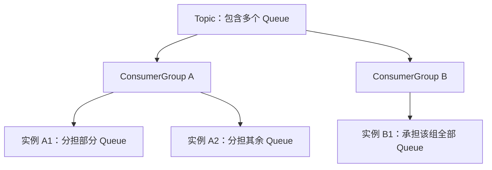
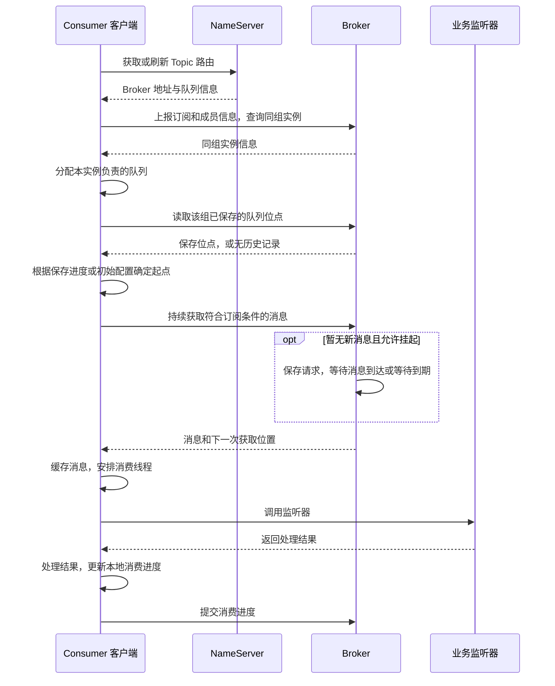

## 1. 消费链路中的基本对象

### 1.1 消费组、实例与订阅关系

Broker 保存消息后，Consumer 根据订阅关系获取消息，再交给业务代码处理。消费组组织承担同类业务职责的消费者，Consumer 实例是实际运行的客户端，订阅关系指定它们要接收哪些消息

| 对象 | 在消费过程中的作用 |
| --- | --- |
| ConsumerGroup | 组织承担同类职责的消费者，关联订阅和消费进度 |
| Consumer 实例 | 建立连接、获取消息并交给业务处理的运行对象 |
| 订阅关系 | 指定接收哪些 Topic，以及各 Topic 的过滤条件 |
| MessageQueue | Topic 下的逻辑队列，通过 Topic、Broker 名称和队列编号定位 |
| QueueOffset | 消息在一个队列中的位置，不同队列分别计算 |

同一个 Topic 可以被多个消费组订阅，各组独立消费、分别推进进度。Group A 已经消费过某条消息，不会因此让 Group B 失去消费机会；消费完成也不会立即删除 Broker 上的消息

同组实例应订阅相同的 Topic，并为每个 Topic 配置一致的过滤类型和表达式。一个实例订阅 `TagA`，另一个订阅 `TagB`，会造成订阅不一致，影响组内消息消费

### 1.2 集群消费与广播消费

`DefaultMQPushConsumer` 默认使用集群消费，即 `MessageModel.CLUSTERING`。同组实例分担队列，一个实例只处理分配给自己的部分；不同组仍然可以独立处理相同的消息

广播模式 `MessageModel.BROADCASTING` 则让同组每个实例都处理订阅 Topic 下的全部队列，各自按过滤条件和消费位点获取仍在保留范围内的消息

| 方式 | 消息怎样分担 | 默认进度保存方式 |
| --- | --- | --- |
| 同组集群消费 | 同组实例分担队列 | Broker 保存该组各队列的进度 |
| 同组广播消费 | 每个实例处理全部订阅队列 | 各客户端分别保存本地进度 |
| 不同组订阅同一 Topic | 各组独立消费 | 按各组采用的消费模式分别管理 |

组内广播通过消费模式配置，组间独立消费通过消费组身份区分。两者都能让多个实例处理同一条消息，进度和失败结果则按各自的消费模式管理

下面是两个消费组独立订阅、组内实例分担队列的关系图，箭头表示逻辑关系，不表示网络转发



### 1.3 消费者类型与业务接口

三种消费者的主要区别是消息由谁获取，以及处理完成后怎样提交结果

| 类型 | 使用方式 |
| --- | --- |
| PushConsumer | SDK 在后台获取消息并调用监听器，业务处理后返回成功或失败 |
| SimpleConsumer | 业务主动接收消息，自行安排处理，成功后逐条确认（ACK） |
| PullConsumer | 业务按队列和位点拉取消息，处理后更新消费位点 |

PushConsumer 通过回调把消息交给业务，SDK 可以在后台主动拉取。SimpleConsumer 和 PullConsumer 都由业务主动获取，前者确认单条消息，后者通过队列位点管理进度

下面沿 `DefaultMQPushConsumer` 配合 `MessageListenerConcurrently` 的普通并发消费路径展开，其中持续获取消息、安排回调和提交进度都由 SDK 在后台组织

### 1.4 订阅与 Tag 过滤

订阅表达式可以接收所有 Tag，也可以选择一个或多个 Tag：

```java
consumer.subscribe(topic, "*");
```

第二个参数为 `"*"` 时接收所有 Tag，`"TagA"` 表示只接收一种，`"TagA || TagB"` 表示接收其中任意一种。对同一个 Topic 再次调用 `subscribe()` 会更新表达式，不会自动叠加条件

Tag 是消息属性，与消息体里的同名字段无关。Key 用于查询和业务关联，不参与 Tag 匹配。需要按消息属性组合更复杂的条件时，可以使用 SQL92 过滤，并确认 Broker 已开启相应支持

过滤主要在 Broker 获取消息时执行，客户端解码结果后还会核对 Tag 字符串，再将符合条件的消息交给消费服务

## 2. 消费之前，客户端准备了什么

### 2.1 业务配置与后台运行资源

业务通过 `DefaultMQPushConsumer` 设置消费组、订阅和监听器。启动之后，SDK 在后台维护一套运行资源，让业务不必自己管理连接和持续获取消息的循环

```text
Consumer 客户端
├── 路由与连接：找到并访问 Broker
├── 订阅与成员信息：确定消息范围和同组实例
├── 队列分配：确定当前实例承担的工作
├── 本地缓存与消费线程：衔接获取消息和执行业务
└── 消费进度：记录处理位置并提交保存
```

消息获取、业务处理和进度提交分别推进：消息已经进入缓存时，业务线程可能还没开始执行；业务处理结束时，最新进度也可能尚未提交到 Broker

### 2.2 start() 建立运行条件

配置和监听器就绪后，业务调用 `start()`。客户端会检查配置、准备消费线程和进度存储、启动通信与后台任务，然后获取路由、向 Broker 上报订阅和成员信息，并触发队列分配

NameServer 提供 Topic 对应的 Broker、队列和地址信息，心跳则让 Broker 了解消费组成员和订阅状态。消费者根据路由连接 Broker，消息不经过 NameServer 转发

启动后，后台任务继续维护这些状态。分到队列并取得符合订阅和位点条件的消息后，客户端才会调用业务监听器

应用进程正常运行时，消费者仍可能遇到连接、订阅或分配问题。`consumerConnection` 可用于查看消费组的在线连接和订阅，客户端日志则用于检查路由更新、心跳失败或分配异常

## 3. Topic 的队列怎样分配给实例

### 3.1 从可读路由到本实例负责的队列

客户端从 Topic 路由取得可读队列，从 Broker 取得同组在线实例，再按分配策略计算自己负责的队列。默认策略按队列数量平均分配

假设一个 Topic 有 Q0～Q3 四个可读队列，实例能力相近，采用默认平均分配策略，稳定后的分配可以表示为：

| 同组实例数 | 分配示意 |
| --- | --- |
| 1 | 一个实例承担四个队列 |
| 2 | 每个实例承担两个队列 |
| 4 | 每个实例承担一个队列 |
| 6 | 四个实例各承担一个队列，另外两个没有分到该 Topic 的队列 |

队列分配决定实例之间的分工，消费线程池决定实例内部怎样执行任务。使用并发监听器时，多个线程可以处理同一队列的不同消息

> **为什么增加了消费者实例，消费速度却没有提高？**
>
> 在队列粒度的集群消费中，新实例需要分到队列才能承担工作。四个队列已经由四个实例分别负责时，再增加实例也无法继续拆分这些队列。
>
> 即使队列数量足够，按队列平均分配也不等于处理负载均匀：消息集中在少数队列、某个实例处理较慢，或者下游数据库已经达到处理上限，都可能限制吞吐。应先看实际分配、各队列积压和业务耗时，再判断扩容是否有效

### 3.2 队列粒度与消息粒度

队列粒度以队列为单位分配工作，消息粒度则允许同组多个实例分担同一队列中的不同消息，并通过单条消息的获取和确认状态协调处理

`DefaultMQPushConsumer` 默认按队列分配，PullConsumer 的读取也围绕队列组织，SimpleConsumer 使用消息粒度。“实例数超过队列数就会闲置”的判断只适用于队列粒度，不能用于所有消费者；PushConsumer 的实际负载粒度还取决于具体 SDK

### 3.3 扩缩容时怎样重新分工

实例上线、下线或队列集合变化后，客户端需要重新计算队列归属，这个过程称为重平衡（Rebalance）。定期检查和成员变化通知都可以触发重平衡，各实例完成切换需要一定时间

重新分配后，原实例停止获取不再负责的队列，新实例从该组已保存的进度接手。原实例的内存缓存不会随队列迁移，已经开始执行的业务也不会自动撤销，所以交接期间可能出现短暂波动或重复处理

实例闲置时，应先核对该 Topic 的可读队列数、同组在线实例数和实际分配结果，再检查成员是否频繁上下线。客户端重平衡日志中的 `group`、`topic`、`clientId` 和分配集合，可以用来确认队列归属及其变化

## 4. 消息怎样到达业务监听器

### 4.1 后台获取与长轮询

取得队列分配和起始位点后，客户端在后台持续向 Broker 获取消息。请求包含消费组、目标队列、读取位置、批量大小和订阅信息，Broker 检查权限及相关条件，再返回符合要求的消息

如果暂时没有新消息，并且请求允许挂起，Broker 可以保存这个拉取请求，等到消息到达或等待时间到期后再处理和响应，这就是长轮询。等待期间保留的是请求状态，不需要为每个请求一直占用处理线程，也减少了客户端反复查询空队列的开销

`DefaultMQPushConsumer` 由 SDK 持续安排拉取，业务等待监听器回调。SimpleConsumer 由业务主动调用接收接口，无需指定队列位点；PullConsumer 则按队列和位点组织读取。长轮询描述的是请求如何等待消息，消费者类型决定获取流程由谁组织

### 4.2 拉取结果怎样变成本地消费任务

取得消息后，客户端先把消息放入本地缓存，再交给消费线程执行。后台获取可以继续进行，不必每拉一批就等待这批业务全部完成

```text
Broker 返回消息 → 客户端缓存 → 等待消费线程 → 执行业务回调
```

缓存使网络获取和业务执行能够并行推进。业务变慢时，已经拉到的消息可能仍在等待回调；缓存中也可能包含正在处理的消息，因此缓存数量不等于线程池中的等待任务数

PushConsumer 的缓存和消费线程主要由 SDK 管理。SimpleConsumer 和 PullConsumer 取得消息后，业务可以直接处理，也可以交给自己的线程池。排查积压时，前者要看 SDK 的消费线程和缓存，后两者还要检查业务自己的处理队列

一次没有取得消息，可能只是暂时没有新消息或没有匹配的 Tag。空结果本身不代表获取失败，连接、权限和位点问题需要结合响应与日志判断

### 4.3 业务回调与消费结果

消费线程调用业务注册的 `MessageListenerConcurrently`，把消息列表交给回调处理。拉取批量控制一次网络请求获取多少消息，消费批量控制一次回调处理多少消息，两者分别配置

使用并发监听器时，多个任务可以同时运行，同一队列中后面的消息也可能先完成。需要顺序保证时要采用对应的消费方式，单靠队列内有序存储不能推导出业务执行有序

| 回调结果 | 框架怎样理解 |
| --- | --- |
| `CONSUME_SUCCESS` | 本次回调报告成功，默认确认这批消息 |
| `RECONSUME_LATER` | 本次回调报告失败，进入后续失败处理 |
| 抛异常或返回 `null` | 由消费服务按失败处理 |

SDK 根据回调返回值判断处理结果。业务应在处理完成后返回成功；如果只是把任务交给另一个线程就返回成功，后续业务失败便无法通过这次回调报告给 SDK

失败处理还受消费模式影响。广播模式下，客户端记录失败后继续推进，不提供与集群模式相同的服务端重试

### 4.4 本地缓存、流控与消费积压

拉取与消费可以并行运行，但本地缓存不能无限增长。消息积存在本地、达到限流条件时，客户端会延后拉取，让业务处理有机会赶上

> **Broker 上还有消息积压，客户端为什么反而减少拉取？**
>
> 因为已经拉到本地的消息还没处理完，触发了客户端限流。客户端会延后下一次拉取，避免继续增加本地负担；Broker 上有积压，不代表客户端此刻还有能力接收更多消息。
>
> 这时应结合缓存状态、消费线程和回调耗时检查业务是否阻塞。直接调高拉取阈值，可能只是把更多积压搬进客户端内存，并没有提高实际处理速度

| 观察到的现象 | 优先检查 |
| --- | --- |
| Broker 端进度差值持续扩大，本地缓存少，获取异常多 | 实际队列分配、订阅、连接、Broker 响应与客户端暂停状态 |
| 本地缓存持续增多，回调进入较慢 | 消费线程是否被占满、任务是否等待、是否有阻塞调用 |
| 回调能持续进入，但完成耗时变长 | 数据库、下游接口、连接池、锁等待及具体业务耗时 |
| 只有少数队列明显积压 | 队列热点、对应实例负载及重平衡状态 |

`consumerProgress` 用于查看队列层面的消费进度，`consumerStatus` 可提供客户端运行信息、缓存状态和消费统计。具体业务耗时还需要结合应用日志，用消费组、Topic、队列、QueueOffset、消息 ID 或业务 Key 关联处理开始、结束和结果，无需打印完整消息体

增加线程之前，先判断下游是否还有处理余量。数据库连接池已经耗尽时，更多消费线程可能只是产生更多等待

## 5. 处理结果怎样变成消费进度

### 5.1 拉取位置与消费位点分别推进

拉取位置表示客户端接下来从哪里获取消息，消费位点记录这个组在该队列上的处理进度。消息先进入缓存、再等待业务执行，因此拉取位置可以领先于消费位点

在普通队列消费中，提交的位点表示下次继续处理的起点。例如 100～109 已经处理完，没有更早的消息未完成，位点可以推进到 110；即使客户端已经拉到 119，也不能直接把消费进度提交为 120

并发处理时，后面的消息可能先完成。如果 100 仍在处理中，101、102 已经成功，进度仍可能停在 100。遇到进度停滞时，除了检查线程是否停止工作，也要留意是否有较早的消息处理缓慢

过滤和重试也会影响位点的解释：不匹配的消息可以被跳过，失败消息可能转入重试路径后让原队列继续推进。队列位点差值适合观察积压趋势，但不能直接当成精确的未完成业务数

### 5.2 业务完成后，进度还要保存

`DefaultMQPushConsumer` 在集群模式下根据回调结果更新本地进度，再由 SDK 提交给 Broker 保存。回调结束与进度提交之间可能有时间差，Broker 保存的位置便会暂时落后于客户端

广播模式默认将进度持久化到客户端本地文件，恢复时依赖对应的客户端身份和本地存储。更换机器、改变身份或丢失文件，都可能影响原有进度的恢复

三种方式报告处理结果的入口不同：

| 类型 | 业务处理完成后做什么 |
| --- | --- |
| DefaultMQPushConsumer | 回调返回成功，由 SDK 更新并提交队列进度 |
| SimpleConsumer | 主动 ACK 确认已完成的消息 |
| PullConsumer | 根据实际处理进度更新并提交队列位点 |

SimpleConsumer 接收消息后，这些消息会在一段时间内对同组其他消费者不可见。如果这段时间结束时仍未确认，消息可能再次投递。遇到重复消费时，要结合业务耗时检查 ACK 是否成功、是否及时

业务数据库事务与进度提交或 ACK 是独立操作。如果业务已经写入数据库，进程却在结果提交成功前退出，消息就可能再次被处理。三种方式都需要业务幂等保护

### 5.3 重启旧组与启动新组的起点

`DefaultMQPushConsumer` 开始处理一个队列时，先读取该组已保存的位点；只有没有历史记录时，才按 `consumeFromWhere` 配置确定初始位置

| 情形 | 普通 Topic 队列的起点 |
| --- | --- |
| 原消费组已有保存位点 | 优先从保存位置继续 |
| 无保存位点，`CONSUME_FROM_LAST_OFFSET` | 从计算起点时的队列末尾开始 |
| 无保存位点，`CONSUME_FROM_FIRST_OFFSET` | 从头请求，受当前仍保留的消息范围限制 |
| 无保存位点，`CONSUME_FROM_TIMESTAMP` | 根据配置时间查询初始位点 |

`DefaultMQPushConsumer` 默认使用 `CONSUME_FROM_LAST_OFFSET`。从头或按时间消费都受消息保留范围限制，已经被清理的历史消息无法仅靠调整位点找回

PullConsumer 恢复时，业务依据保存的进度确定读取位点。SimpleConsumer 的接收接口不直接指定队列位点，也不使用这组 `consumeFromWhere` 配置。排查重启后的消费范围时，应先确认接入类型，再检查相应的进度记录

> **已经设置从头消费，为什么重启后还是从原来的位置继续？**
>
> 因为该组在对应队列上已有保存位点，初始策略不会覆盖它。全新消费组没有原组的进度记录，起点由实际配置决定；修改业务组位点会改变后续消费范围，不宜作为检查单条消息的手段

## 6. 一次消息消费的完整流转

`DefaultMQPushConsumer` 注册订阅和监听器后，普通集群消费的过程如下。后台获取和业务处理可以交叠，进度按 SDK 的提交机制保存



订阅确定消息范围，路由和重平衡确定获取目标，缓存衔接后台拉取与业务回调，消费结果再推动位点更新。Broker 保存消息和消费组提交的进度，供消费者继续处理或重启恢复

发送方拿到 `SendResult` 后，消费方还要独立完成这些步骤。排查时应分别确认消息是否已获取、业务是否已完成、结果是否已提交，发送成功只能说明发送侧的结果
